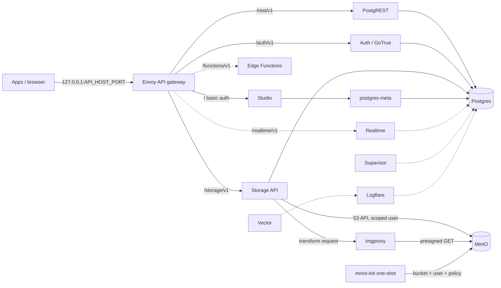

# supabase-minio-template

A self-hosted [Supabase](https://supabase.com) stack in Docker Compose, with
**Supabase Storage backed by MinIO (S3)**. Secure defaults, pinned images,
low memory use, and a smoke test that proves the whole storage path works.

Based on the official [`supabase/docker`](https://github.com/supabase/supabase/tree/master/docker)
self-hosting setup and the
[self-hosted S3 storage guide](https://supabase.com/docs/guides/self-hosting/self-hosted-s3).

- Postgres, PostgREST, Auth (GoTrue), Envoy API gateway, Storage API, imgproxy,
  postgres-meta and Studio
- Storage uses `STORAGE_BACKEND=s3` against MinIO, through a **bucket-scoped
  MinIO user** (the root account is only used for bootstrap)
- Optional profiles for Realtime, Edge Functions, Logflare/Vector analytics and
  Supavisor, off by default
- Every port bound to `127.0.0.1`, random secrets generated locally, memory
  limits, health checks and named volumes for every service
- `make smoke` checks REST, Auth, Storage, MinIO, RLS and image transformation
  end to end; CI runs it on every push

> Use this repository as a template ("Use this template" on GitHub), then
> follow the quickstart.

## Quickstart

Requirements: Docker Engine with Compose v2, `bash`, `openssl`, `curl`, `make`.

```sh
make env      # writes .env with fresh random secrets (never printed)
make up       # starts the stack and waits until every service is healthy
make smoke    # end-to-end check
```

`make up` prints the local endpoints:

```
API / SUPABASE_URL : http://127.0.0.1:58000
Studio             : http://127.0.0.1:58000/   (DASHBOARD_USERNAME / DASHBOARD_PASSWORD in .env)
Postgres           : 127.0.0.1:58432
MinIO console      : http://127.0.0.1:58901  (MINIO_ROOT_USER / MINIO_ROOT_PASSWORD in .env)
```

The first start pulls the images (about 6 GB on disk, mostly Postgres,
Studio and Storage). Later starts take 30-60 seconds.

### Commands

| Command | What it does |
| --- | --- |
| `make env` | Generate `.env` from `.env.example` (`FORCE=1` replaces an existing one, keeping a backup) |
| `make up` / `make down` | Start and wait for health / stop (volumes are kept) |
| `make status` | Container state, health and memory use |
| `make logs [SERVICE=storage]` | Follow logs |
| `make psql` | `psql` inside the database container |
| `make backup` | `pg_dump` + MinIO bucket mirror into `backups/<timestamp>/` |
| `make restore BACKUP=backups/<timestamp>` | Restore a backup into the running stack |
| `make smoke` | End-to-end smoke test |
| `make config` / `make pull` | Validate compose file / pull pinned images |
| `make clean` | **Delete all data**: `down -v` after confirmation |

The scripts in `scripts/` can be used directly as well
(`scripts/gen-env.sh --help`).

## Architecture



Dashed lines are optional profiles. Storage keeps object metadata (buckets,
object rows, RLS policies) in Postgres and the bytes in a single MinIO bucket
(`GLOBAL_S3_BUCKET`) under `<STORAGE_TENANT_ID>/<bucket>/<path>/<version>`.
For image transformations Storage hands imgproxy a short-lived presigned MinIO
URL, so imgproxy needs no credentials or shared volume.

## Services and ports

Only these ports are published, all on `127.0.0.1`. Change them in `.env`.

| Service | Host port (default) | `.env` key |
| --- | --- | --- |
| API gateway: REST, Auth, Storage, Realtime, Functions, Studio | 58000 | `API_HOST_PORT` |
| Postgres (direct) | 58432 | `DB_HOST_PORT` |
| MinIO S3 API | 58900 | `MINIO_API_HOST_PORT` |
| MinIO console | 58901 | `MINIO_CONSOLE_HOST_PORT` |
| Supavisor session / transaction (profile `pooler`) | 58433 / 58543 | `POOLER_SESSION_HOST_PORT`, `POOLER_TRANSACTION_HOST_PORT` |

The defaults avoid the ports used by the Supabase CLI (`54321`-`54324`) and
common dev ports. To pick other ports at generation time:

```sh
./scripts/gen-env.sh API_HOST_PORT=59000 DB_HOST_PORT=59432
```

`SUPABASE_PUBLIC_URL` and `API_EXTERNAL_URL` follow `API_HOST_PORT`
automatically. Set `COMPOSE_PROJECT_NAME` to run several copies side by side.

### Optional services

Enable profiles in `.env` and run `make up`:

```sh
COMPOSE_PROFILES=realtime,functions
```

| Profile | Services | Memory limit |
| --- | --- | --- |
| `realtime` | Realtime | 512 MiB |
| `functions` | Edge Functions (code in `volumes/functions/`; try `/functions/v1/ping`) | 512 MiB |
| `analytics` | Logflare + Vector; also set `STUDIO_LOGS_ENABLED=true` | 1 GiB + 256 MiB |
| `pooler` | Supavisor | 512 MiB |

The upstream `hello` example function uses `@supabase/server`, which only
accepts the newer `sb_publishable_`/`sb_secret_` keys (not generated here, see
below); `ping` works with the generated keys.

To turn a profile off again, run `make down` *before* removing it from
`COMPOSE_PROFILES`, or stop the container by hand.

## Connecting from apps

Use the API gateway URL and the keys from `.env`:

| Setting | Value |
| --- | --- |
| `SUPABASE_URL` | `SUPABASE_PUBLIC_URL` from `.env` (default `http://127.0.0.1:58000`) |
| anon / public key | `ANON_KEY` from `.env`; safe in browsers, access is governed by RLS |
| service role key | `SERVICE_ROLE_KEY` from `.env`; **server side only**, bypasses RLS |

```js
import { createClient } from '@supabase/supabase-js'

const supabase = createClient(process.env.SUPABASE_URL, process.env.SUPABASE_ANON_KEY)

const { data, error } = await supabase.storage
  .from('avatars')
  .upload('user-1/avatar.png', file, { contentType: 'image/png' })

const { data: thumb } = await supabase.storage
  .from('avatars')
  .createSignedUrl('user-1/avatar.png', 60, { transform: { width: 128, height: 128 } })
```

Direct Postgres: `postgresql://postgres:<POSTGRES_PASSWORD>@127.0.0.1:58432/postgres`.

The keys are long-lived (5 years) HS256 JWTs signed with `JWT_SECRET`. The
newer opaque `sb_publishable_...` / `sb_secret_...` keys and asymmetric signing
keys are not generated; the gateway runs in legacy key mode. Add them with the
upstream [auth keys guide](https://supabase.com/docs/guides/self-hosting/self-hosted-auth-keys)
if you need them.

## Smoke test

`make smoke` (also run in CI) verifies, against the running stack:

1. PostgREST answers (OpenAPI with the service key) and an anon query returns a
   row through an RLS policy, while an anon insert is rejected
2. Auth `/auth/v1/health` is healthy
3. A private bucket can be created with the service key
4. A 256 KiB random file uploaded with the service key downloads back
   byte-identical (sha256)
5. The object physically exists in the MinIO bucket (listed with the
   bucket-scoped storage user over the S3 API)
6. Anon can neither upload to nor read from the private bucket
7. imgproxy returns a 16x12 thumbnail of a 64x48 PNG through
   `/storage/v1/render/image/...`

It creates a temporary table and bucket and removes them afterwards.

## Backups

`make backup` writes `backups/<timestamp>/` (git-ignored, mode 700):

- `db.dump`: `pg_dump -Fc` of the `postgres` database as `supabase_admin`
  (all schemas, including `auth` and `storage` metadata)
- `storage/`: `mc mirror` of the MinIO bucket (the object bytes)

Both parts are needed: the database holds the object metadata, MinIO the
contents. Take them together, ideally while writes are paused.

`make restore BACKUP=backups/<timestamp>` restores both into the running
stack (`pg_restore --clean --if-exists`, then `mc mirror --overwrite`) and
restarts `rest` and `storage`. CI exercises this round trip.

For production, copy backups off the host, encrypt them, and test restores
regularly. MinIO's own replication or `mc mirror --watch` to another S3 target
can complement the database dumps.

## Upgrading pinned versions

Every image has an exact tag; MinIO is pinned by digest (see below).

1. Check [`docker/versions.md`](https://github.com/supabase/supabase/blob/master/docker/versions.md)
   and the [changelog](https://github.com/supabase/supabase/blob/master/docker/CHANGELOG.md)
   upstream, and copy the new tags into `docker-compose.yml`. Upgrade one
   component at a time when possible.
2. Compare the vendored configs in `volumes/` with upstream (especially
   `volumes/api/envoy/*`), since new versions sometimes need config changes.
3. `make backup`, then `make pull && make up && make smoke`.
4. Postgres major upgrades need a migration (see upstream `utils/upgrade-pg17.sh`);
   do not just change the major version tag.

**MinIO image.** MinIO no longer publishes open-source Docker images. Like the
official Supabase override, this template uses Chainguard's build
(`cgr.dev/chainguard/minio`), which is only tagged `latest`, so it is pinned by
digest. To update:

```sh
docker pull cgr.dev/chainguard/minio:latest
docker inspect --format '{{index .RepoDigests 0}}' cgr.dev/chainguard/minio:latest
```

and put the digest into `docker-compose.yml`, or override it with
`MINIO_IMAGE=...` in `.env` (any MinIO-compatible image that ships `mc` and
`/bin/sh` works). Upstream Supabase suggests RustFS for new deployments; this
template sticks with MinIO by design.

## RAM footprint

Measured with `docker stats --no-stream` right after `make smoke` on the
default profile (no optional services):

| Container | Memory used | Limit |
| --- | ---: | ---: |
| minio | 254 MiB | 512 MiB |
| studio | 211 MiB | 512 MiB |
| meta | 103 MiB | 256 MiB |
| storage | 84 MiB | 256 MiB |
| db | 75 MiB | 1 GiB |
| api-gw (Envoy) | 26 MiB | 128 MiB |
| imgproxy | 16 MiB | 256 MiB |
| rest | 14 MiB | 128 MiB |
| auth | 10 MiB | 128 MiB |
| **total** | **~790 MiB** | 3.4 GiB |

Studio and postgres-meta account for about 300 MiB; if you do not need the
dashboard on a server, `docker compose stop studio meta` (the gateway keeps
serving the APIs, only `/` stops working; measured total without them: ~490 MiB).

With all four profiles enabled the CI run measures about 1.7 GiB in total
(Logflare ~520 MiB, Realtime ~190 MiB, Supavisor ~180 MiB, Edge Functions
~40 MiB idle, Vector ~30 MiB).

Memory limits (`mem_limit`) are set per container and can be changed through
the `*_MEM_LIMIT` keys in `.env`. Postgres and MinIO grow with data and load;
give them more on a real server.

## Security notes

- **Loopback only.** Every published port binds to `127.0.0.1`. Nothing is
  reachable from the network until you add a reverse proxy.
- **Secrets.** `make env` creates every secret with `openssl rand` and signs the
  anon/service JWTs locally. `.env` is created with mode 600 and git-ignored;
  the scripts never print secrets (the smoke test passes keys to `curl` via
  files, not the command line).
- **Regenerating `.env`** with existing volumes breaks logins, because Postgres
  and MinIO keep the passwords from the first start. Either keep `.env` or
  `make clean` first.
- **Service role key and `JWT_SECRET`** grant full access. Keep them on the
  server side. Rotating `JWT_SECRET` invalidates all issued keys and sessions.
- **MinIO.** Storage uses a MinIO user whose policy only allows its own bucket.
  The MinIO root account and console stay on loopback; do not expose them.
  Objects in MinIO are only protected by Storage's RLS when accessed through the
  API; direct MinIO access bypasses it.
- **Studio** sits behind HTTP basic auth (`DASHBOARD_USERNAME` /
  `DASHBOARD_PASSWORD`) at the gateway root. Over plain HTTP that password
  travels in clear text, so only expose Studio through TLS, or better, keep it
  internal (SSH tunnel, VPN).
- **Email.** No SMTP server is configured and auto-confirm is off; set the
  `SMTP_*` values before relying on email sign-up.
- **Analytics profile** mounts the Docker socket (read-only) into Vector, which
  still gives it broad access to the Docker API. Vector only collects logs of
  this compose project.
- **Direct Postgres port** accepts the `postgres` role. Keep it on loopback and
  use the pooler or an SSH tunnel for remote access.

## Exposing behind a reverse proxy with TLS

This repository does not ship a proxy configuration. General guidance:

1. Point a DNS name (e.g. `api.example.com`) at the server and run a TLS
   reverse proxy (Caddy, nginx, Traefik) on the host or in the same compose
   project. Proxy everything to `http://127.0.0.1:58000`.
2. Set the public URLs in `.env`, then `make up`:
   ```sh
   SUPABASE_PUBLIC_URL=https://api.example.com
   API_EXTERNAL_URL=https://api.example.com/auth/v1
   SITE_URL=https://app.example.com
   ADDITIONAL_REDIRECT_URLS=https://app.example.com/**
   ```
3. Pass `Host`, `X-Forwarded-For` and `X-Forwarded-Proto` headers, allow
   WebSocket upgrades on `/realtime/v1/`, and raise the body size limit to at
   least `STORAGE_FILE_SIZE_LIMIT` for uploads.
4. Restrict `/` (Studio) and `/pg/` to trusted networks at the proxy, or do
   not route them publicly at all.
5. Keep MinIO, Postgres and the pooler off the public interface. If you need
   the S3 protocol, use Storage's `/storage/v1/s3` endpoint (keys
   `S3_PROTOCOL_ACCESS_KEY_ID` / `S3_PROTOCOL_ACCESS_KEY_SECRET`).

Minimal Caddy example:

```
api.example.com {
	reverse_proxy 127.0.0.1:58000
}
```

See also the upstream [HTTPS guide](https://supabase.com/docs/guides/self-hosting/self-hosted-proxy-https).

## Repository layout

```
docker-compose.yml        all services; optional ones behind profiles
.env.example              template for .env (secrets marked "generated")
Makefile                  developer commands
scripts/
  gen-env.sh              create .env with random secrets and signed JWTs
  wait-healthy.sh         wait until all services are healthy
  smoke.sh                end-to-end test
  backup.sh, restore.sh   pg_dump + MinIO mirror and back
volumes/
  api/envoy/              gateway config (from upstream)
  db/                     database init scripts (from upstream)
  functions/              Edge Functions (upstream examples + `ping`)
  logs/vector.yml         log routing for the analytics profile
  minio/init.sh           bucket, scoped user and policy bootstrap
  pooler/pooler.exs       Supavisor tenant bootstrap
.github/workflows/ci.yml  lint + smoke test + all-profiles boot test
```

## License

MIT, see [LICENSE](LICENSE). Files derived from the Supabase repository are
under Apache-2.0; see [NOTICE](NOTICE). Not affiliated with Supabase or MinIO.
